# Orble

Orble is a tutor that lives in the MacBook's notch. Ask it about anything on your screen, by voice or by typing. It answers out loud, puts a mark on the exact control you need, and draws the explanation when words are not enough. It never clicks for you: it shows you, and you do it.

  
   
  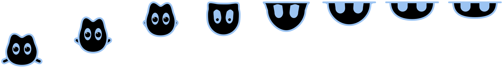
   Orble's buddy, a black bun with soft ears, lives under the notch: he listens while you talk, thinks while Orble thinks and goes to each mark it draws, and at home he becomes Orble's mark.

<!-- demo: the video link goes here -->

  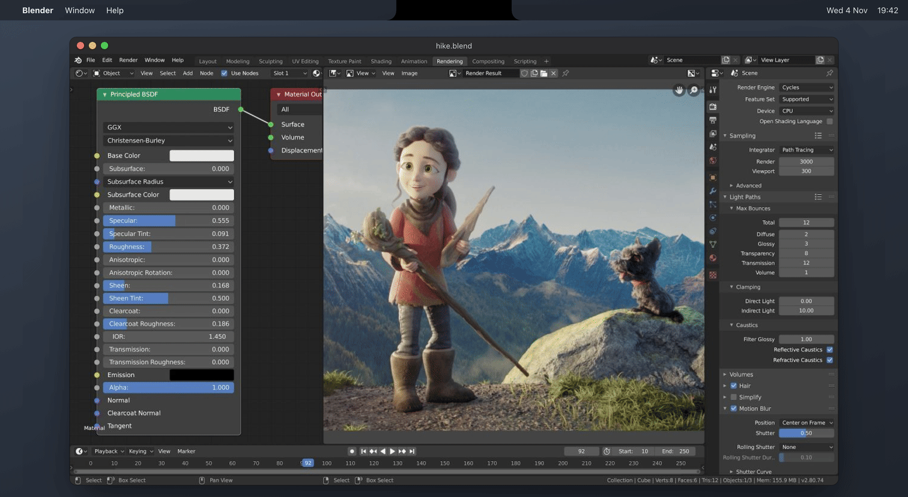
   Asked out loud in Blender: “My render takes forever. What should I change?”

It is a native macOS app written in Rust with Tauri 2. The source is private while it gets ready for release. This repository explains how Orble works and shows what it draws.

## What it does

**It points at the real control.** Ask where a setting is, and Orble puts brackets on the control itself, with a short label beside it. The model only decides *which* control you need. Where the app exposes its accessibility tree, the position comes from macOS, which knows each control's frame to the point.

  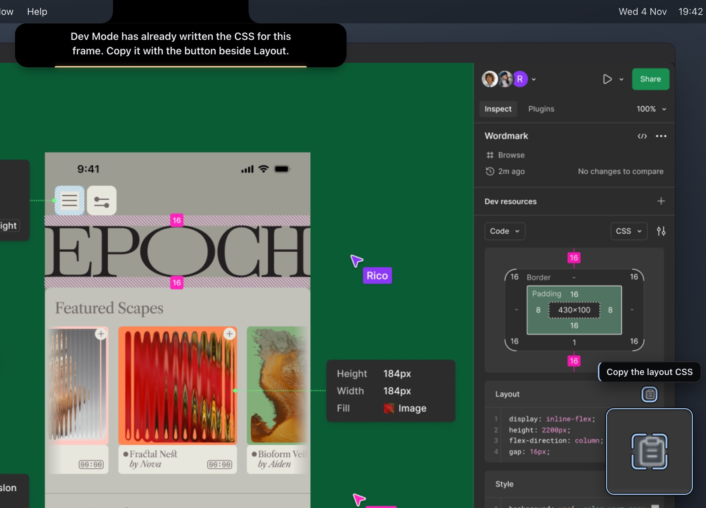
   “How do I copy the CSS for this?” A button too small to see gets a magnified lens beside it.

**It walks you through a task, in any app.** Give it a goal and it plans one step at a time from what is on screen now: it marks the next control, waits for your click, then looks again. There are no scripts written per app. If you go your own way, it re-plans from where you are. A step that moves something, a layer into a group or a piece to its square, gets a movement arrow instead of brackets.

  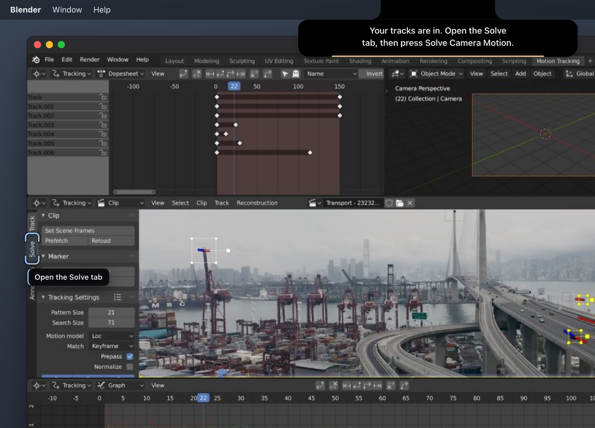
   A live guide toward “solve the camera”. The step's words sit beside its control, and a click on it moves the guide on.

**It draws the explanation.** Equations, matrices, charts, geometry, graphs, code, tables, timelines and trees appear on a board that drops out of the notch. Each panel appears on the sentence that introduces it, and equations are typeset.

  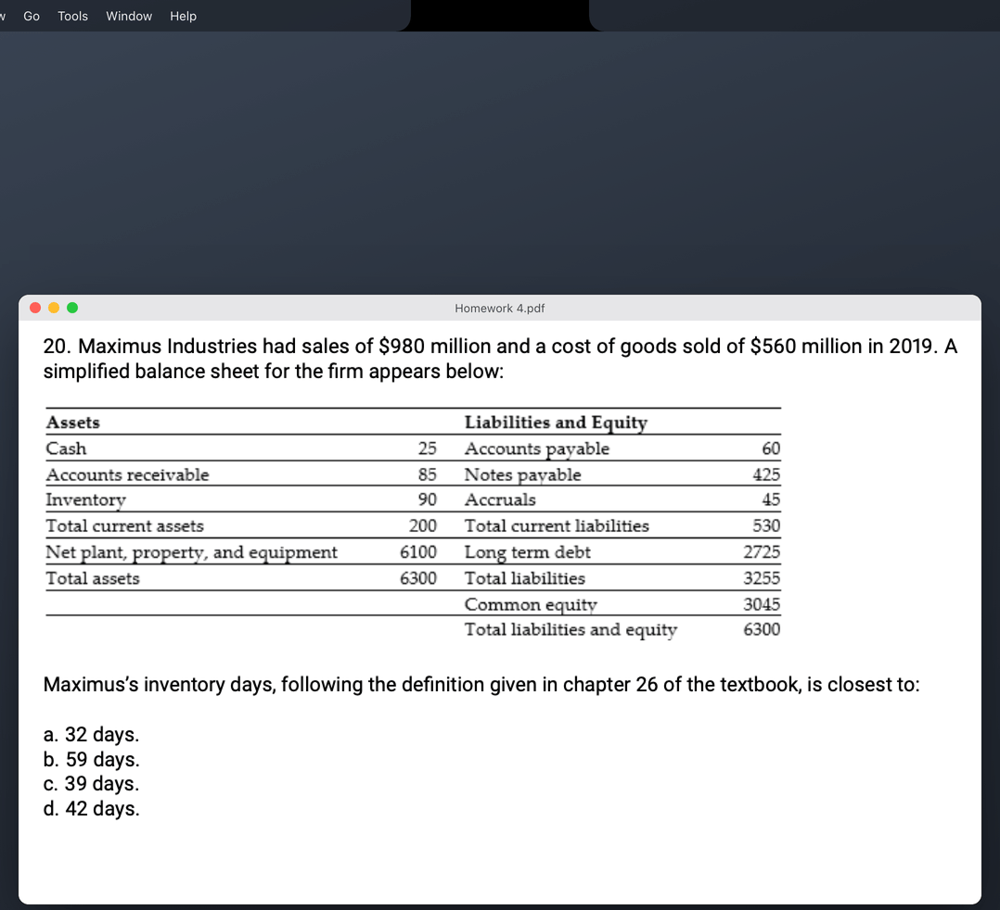
   “How do I get the inventory days?” The board shows the working; the marks show where each number comes from.

**Hold to talk, circle to ask.** Hold the right <kbd>⌘</kbd>, ask, let go: Orble hears you only while you hold it. Move the pointer around anything as you hold it, and your question is about what you circled; the model sees your circle.

**Scribe, for voice typing.** Hold <kbd>⌃</kbd><kbd>⇧</kbd><kbd>Space</kbd>, talk, let go. The text is shaped for where it lands: a list in Notes, a single line in a terminal. It never adds anything you did not say.

**Capture pauses by itself.** Screen capture stops while a password manager, a finance app or a meeting app is in front, and while another app is sharing your screen, and the island says why. Screen frames stay in memory and never touch the disk.

Two more examples, in Figma and Blender

  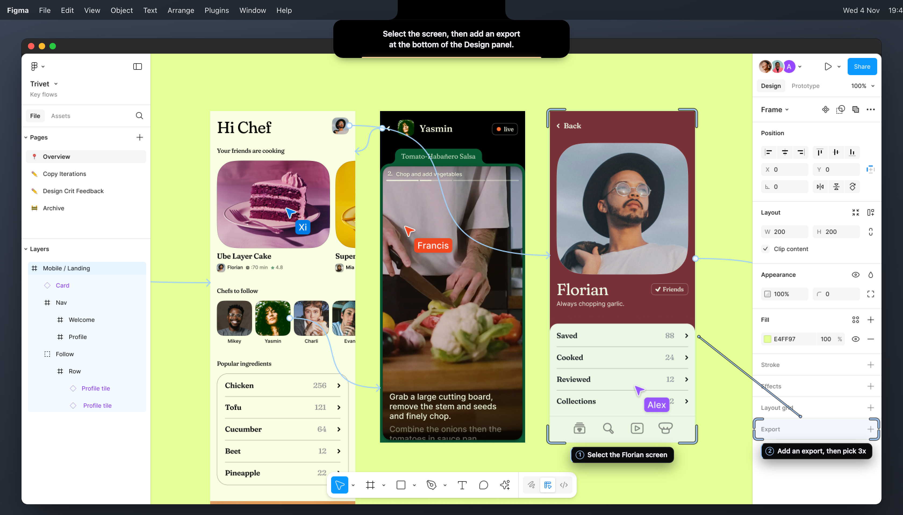
   “How do I export this screen at 3x?” Steps are numbered, and a line joins them in order.

  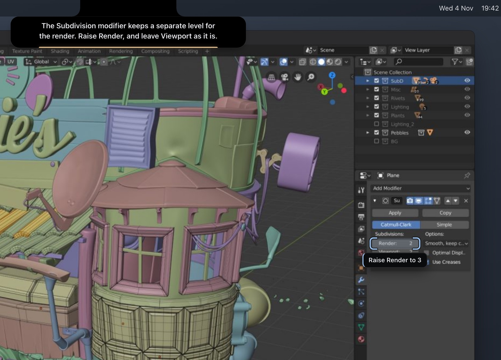
   “Smoother in the final render, but keep the viewport fast?” A mark and the board in one answer.

How these pictures were made: real screenshots of Blender, Figma and a homework sheet (each © its owner), shown at one point per pixel on a mock desktop. The island, the marks and the board are drawn by Orble's own overlay and board code, and the animations are that code captured frame by frame. The targets were placed by hand for the picture. In the app they come from the model, snapped to the accessibility tree where the app exposes one.

## How pointing lands where it should

A model looking at a screenshot is accurate to about 1 to 2 percent of the frame. On a 14-inch MacBook that is 15 to 30 points: close to the right button, but not on it. Orble uses the model's answer to choose the control, then asks macOS where that control actually is.

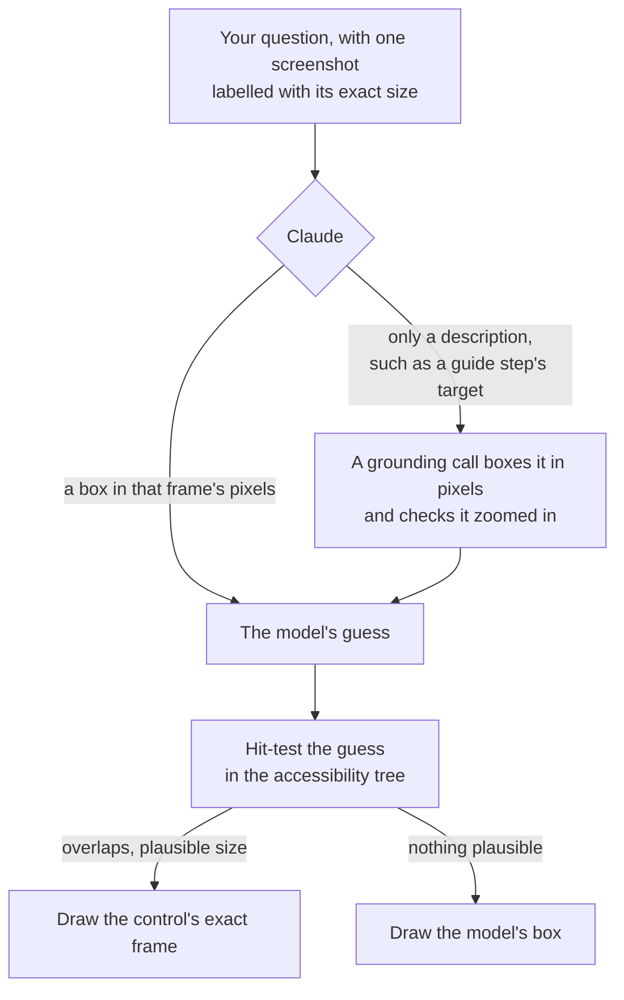

Three rules make this work:

1. **One screenshot per turn, sent at a size the API will not rescale.** The model's pixel coordinates then map one to one onto the screen. They are always resolved against the frame the model saw, never a newer one.
2. **The model points in the frame's own pixels.** A model points best in the format it was trained on, and Claude's is pixel numbers passed as tool arguments, so every pointing tool takes pixels in the frame Claude was shown. A target known only by its description, such as a guide step's, is boxed in pixels by a second call and checked zoomed in.
3. **The operating system has the last word.** A hit is accepted only if it overlaps the guess and is at most 2.5 times its size. A miss keeps the model's box, so this step can only improve a mark.

More in [docs/engineering.md](docs/engineering.md#pointing).

## How the board keeps time with the voice

The model sends an explanation as a list of panels, each with the sentence that goes with it. Panels carry content and structure only, never coordinates: the board does all the layout. A model that is weak at coordinates therefore has nothing positional to get wrong.

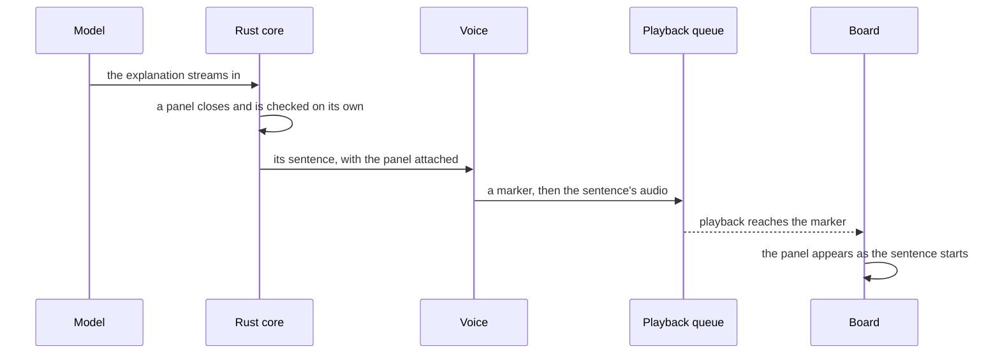

Speech is synthesized ahead of playback, so a timer would drift. Instead, a zero-length marker is placed in the audio queue right before each sentence's samples, and the panel is shown when playback reaches it. If you interrupt, the queued markers are dropped with the audio.

  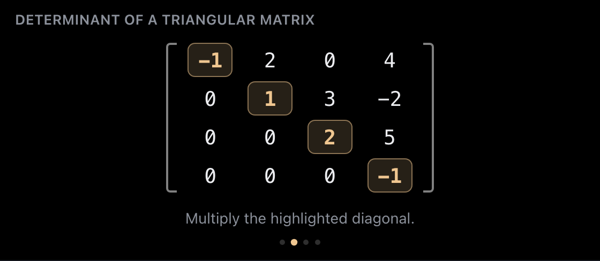
  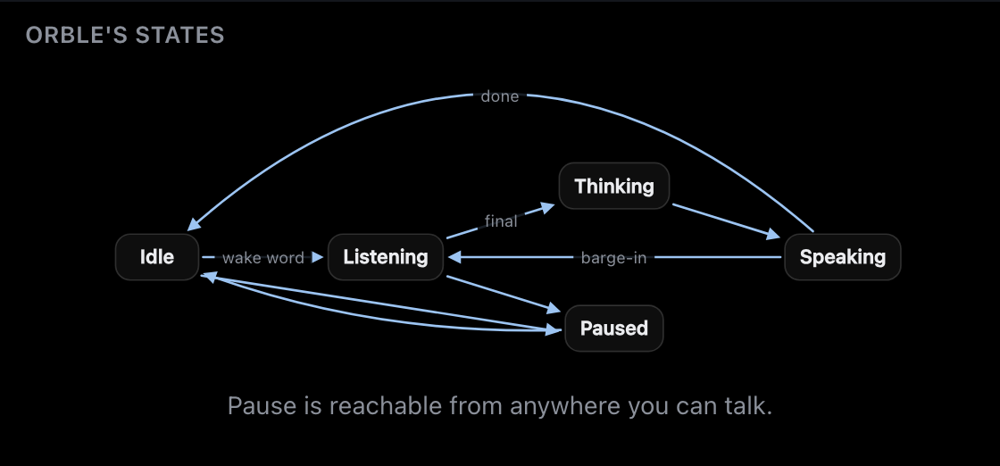

  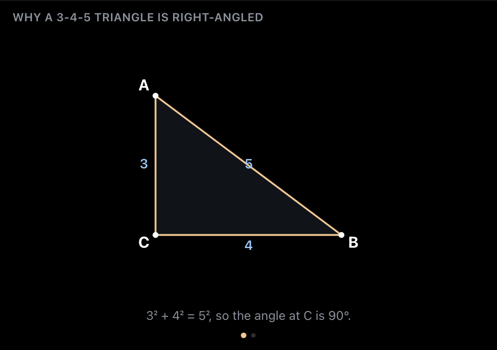
  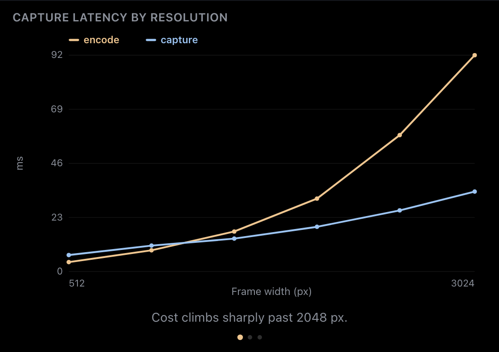

More panels and the rules behind them are in [docs/engineering.md](docs/engineering.md#the-board).

## Architecture

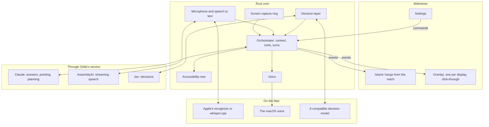

The full tour, including the threads and what each window may call, is in [docs/architecture.md](docs/architecture.md).

## Why it's built this way

- **A Rust core, with Tauri windows.** Capture, listening and playback run all day beside your real work, so they must be cheap and must not pause. Rust calls the accessibility API, CoreAudio and ScreenCaptureKit directly. The windows are webviews in the system's own WebKit, because brackets, labels, equations and charts are what HTML and SVG do well, and the same code runs in headless Chrome for the snapshot tests.
- **It never clicks for you.** An autopilot existed and was removed. Orble's job is to teach you to do the thing.
- **The model chooses; macOS measures.** The model's box only decides which control you mean. The accessibility tree supplies its real frame.
- **A small model makes the small decisions.** Is that line said to Orble? Which of these listed controls is the next step? How hard does this question need thinking about? [Jev](https://typesafe.ai), a hosted decision model, answers in under half a second (481 ms at the median, measured in October), picking only from options the code built. On a guide step it races the full planner, so it can only remove a model call. A compatible model running on the Mac can take its place.
- **No keys, and no model to pick.** People should not have to choose a model or bring their own keys, so the Orble you download reads none. A grown-up connects the Mac to an Orble account once, and Orble's own service carries every model, speech, voice and decision call.

Each decision, and what it costs, is in [docs/decisions.md](docs/decisions.md).

## Engineering

| | |
| --- | --- |
| Code | 180 Rust modules, about 220,000 lines including their tests; about 100 UI scripts, no build step |
| Tests | About 3,700 Rust tests, 1,900 UI tests in Node and 800 Python tests for the tooling |
| Snapshots | 227 board images drawn in headless Chrome and checked against their pixels, and the 3D models drawn live in software WebGL; 18 prompt snapshot files, so any change to what a model is told fails a test until the diff is read and logged |
| Security | A threat model covering 54 outbound data flows and 16 threat classes, with 139 numbered residual risks. A CI check fails if it cites a function, test or file that no longer exists |
| CI | Formatting, Clippy with warnings as errors, tests on Apple Silicon and on Intel under Rosetta, the minimum Rust version (1.88), cargo-deny for advisories and licences, the release bundle with and without Swift, and a copy signed with a throwaway identity |
| Decisions | 33 written decision records, from "Orble teaches; it never drives the Mac" to "Nothing waits on the main thread under a lock the main thread takes". The main ones are summarised in [docs/decisions.md](docs/decisions.md) |
| Languages | Nine for the interface and for what Orble says: English, French, German, Spanish, Italian, Brazilian Portuguese, Japanese, Simplified Chinese and Korean. It also answers in Dutch and Russian |

Some of the problems behind those numbers, in [docs/engineering.md](docs/engineering.md):

- [Pointing that lands on the control](docs/engineering.md#pointing), and why the accessibility walk never goes deep at answer time
- [Panels that land on their words](docs/engineering.md#the-board)
- [Drawing while the answer is still being written](docs/engineering.md#streaming)
- [A window that hangs from the notch on every Mac](docs/engineering.md#the-island)
- [Interrupting a voice the microphone can hear](docs/engineering.md#barge-in)
- [Not paying for silence](docs/engineering.md#cost)
- [Privacy that is checked](docs/engineering.md#privacy)
- [Testing an app no test can launch](docs/engineering.md#testing)

## How it was built

Orble has 2,258 commits made between 14 August and 23 November 2026. I designed it and directed the work. Most of the code was written by AI coding agents (Claude Code), several at a time, each in its own git worktree. My part was the product, the specifications, the order of work, the rules the code must keep, and deciding what ships. Every batch is read by independent review agents and must pass the full test suite before I merge it.

The project's instruction file keeps the hard-won rules, so the same mistake is not made twice. Two examples: "A transparent window still swallows clicks", and "Frames arriving don't prove Screen Recording".

## Status

Pre-release: a free pilot opens around 1 December 2026. Orble runs on macOS 13 and later, on Apple silicon and Intel. Releases are signed with Orble's own identity but not notarised by Apple, so the first time you open Orble, macOS asks you to choose Open Anyway; updates then arrive by themselves and keep its permissions.

There is no key to bring and no model to pick. A grown-up connects each Mac to its Orble account by approving a short code, or scanning its QR code, on their phone. From then on every model, speech, voice and decision call goes through Orble's own service.

- **Answers:** Claude Opus 5.5, in fast mode. The decision layer judges how much thought each question needs (quick, standard or deep) and sets Claude's effort to match. Claude Haiku 5.5 does background work, such as shaping Scribe's text and planning guide steps, and never answers a question.
- **Listening:** AssemblyAI's streaming recognizer, through the service. Apple's on-device recognizer, or whisper.cpp where it is installed, listens on the Mac instead when the person's language needs it or the service is unavailable.
- **Voice:** the Mac's own voice. The service can also carry an ElevenLabs voice, for a plan that includes one.
- **Decisions:** TypeSafe's Jev, through the service, or a compatible model running on the Mac.

## Licence

Copyright © 2026 Erwan Dilliers. All rights reserved. This repository is published for review only; see [LICENSE](LICENSE).
