# Orble

Orble is a tutor that lives in the MacBook's notch. Ask it about anything on your screen, by voice or by typing. It answers out loud, puts a mark on the exact control you need, and draws the explanation when words are not enough. It never clicks for you: it shows you, and you do it.

<!-- demo: the hero GIF and the video link go here -->

  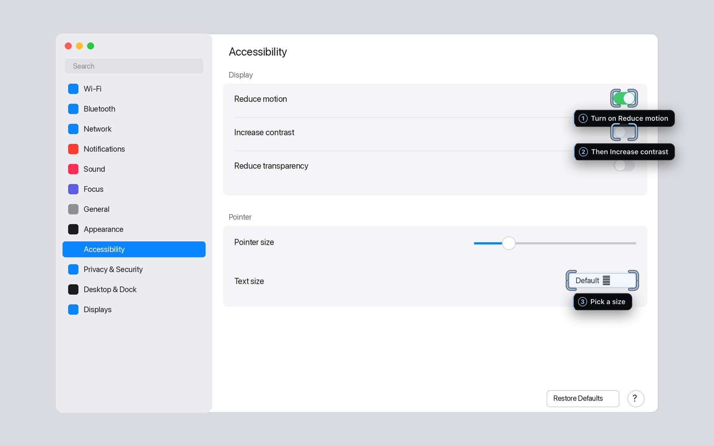

It is a native macOS app written in Rust with Tauri 2. The source is private while it gets ready for release. This repository explains how Orble works and shows what it draws. Every image here was rendered by Orble's own drawing code from its test fixtures.

## What it does

**It points at the real control.** Ask "where do I turn on Reduce motion?" and Orble puts brackets on the switch itself, with the label beside it. The model only decides *which* control you need. The position comes from macOS's accessibility tree, which knows each control's frame to the point.

**It walks you through a task, in any app.** Give it a goal and it plans one step at a time from what is on screen now: it marks the next control, waits for your click, then looks again. There are no scripts written per app. If you go your own way, it re-plans from where you are.

**It draws the explanation.** Equations, matrices, charts, geometry, graphs, code, tables, timelines and trees appear on a board that drops out of the notch. Each panel appears on the sentence that introduces it.

**Circle to ask.** Hold <kbd>⌃</kbd><kbd>⌥</kbd> and move the pointer around anything. Your next question is about what you circled, and the model sees your circle.

**Scribe, for voice typing.** Hold <kbd>⌃</kbd><kbd>⇧</kbd><kbd>Space</kbd>, talk, let go. The text is shaped for where it lands: a list in Notes, a single line in a terminal. It never adds anything you did not say.

**Privacy Mode.** One switch keeps everything on the Mac: speech recognition with whisper.cpp or Apple's on-device recognizer, a local model through Ollama, and the system voice. Capture also pauses by itself for password managers, finance apps, meeting apps and screen sharing.

| | |
| --- | --- |
| 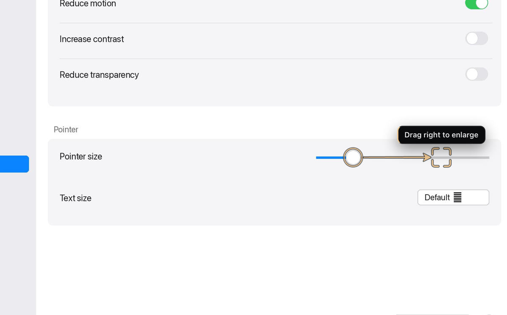 | 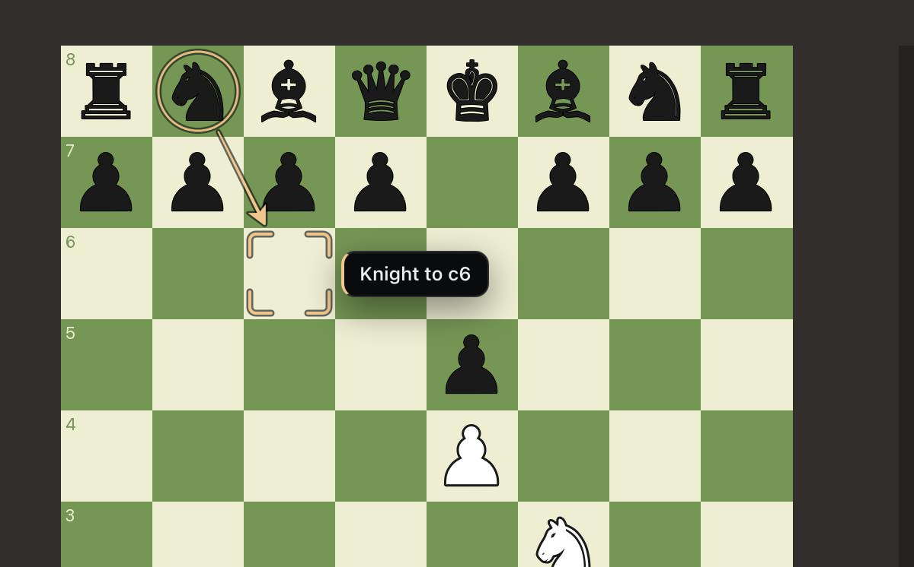 |
| A step that moves something gets a movement arrow. | Guides work in any app, games included. |
| 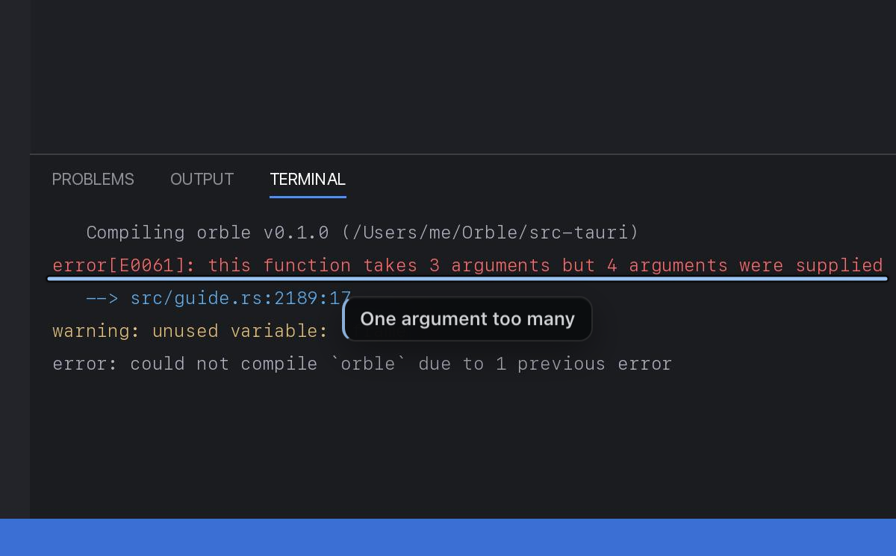 | 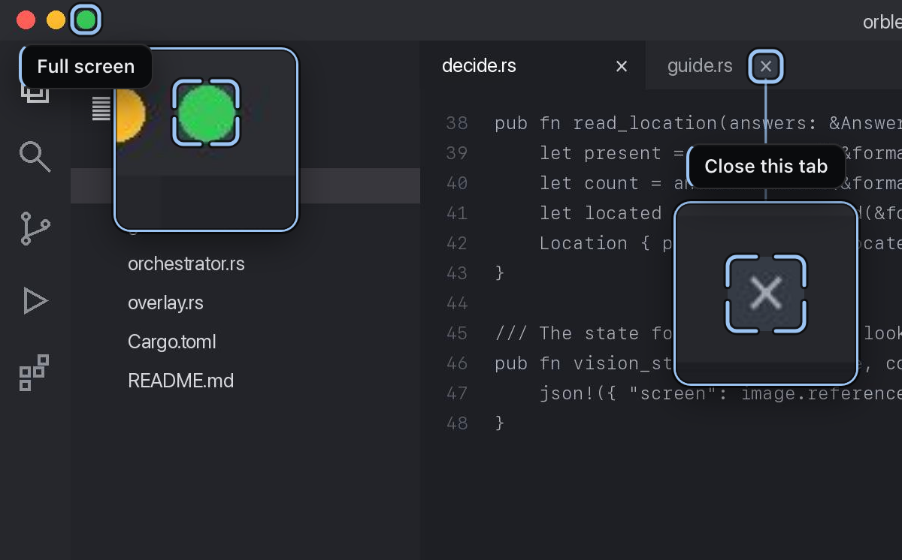 |
| An underline for a line of text, here a compiler error. | A target too small to see gets a magnified lens beside it. |

## How pointing lands where it should

A model looking at a screenshot is accurate to about 1 to 2 percent of the frame. On a 14-inch MacBook that is 15 to 30 points: close to the right button, but not on it. Orble uses the model's answer to choose the control, then asks macOS where that control actually is.

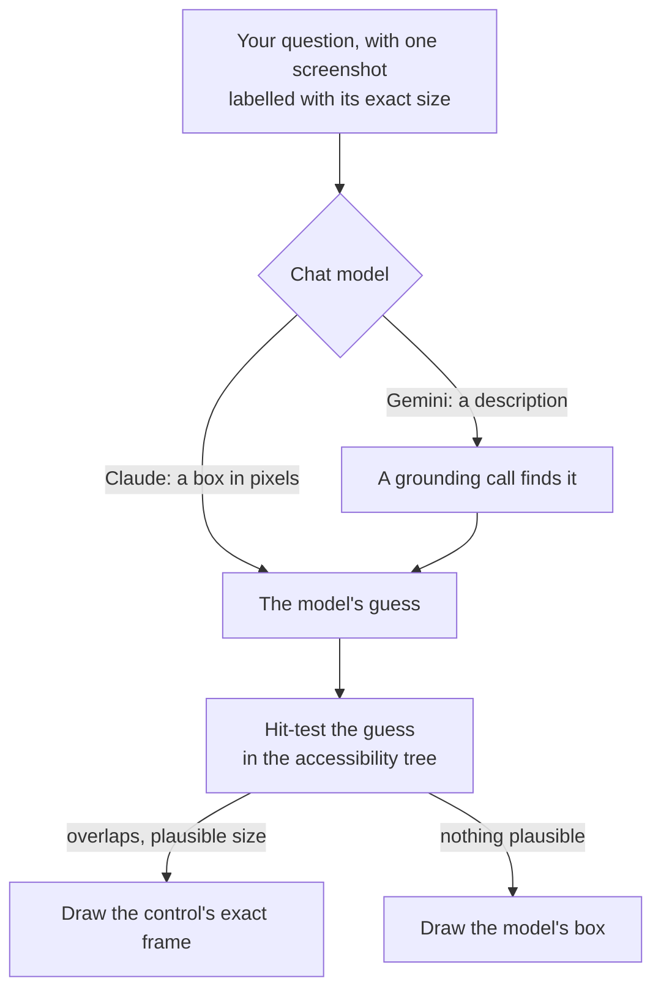

Three rules make this work:

1. **One screenshot per turn, sent at a size the API will not rescale.** The model's pixel coordinates then map one to one onto the screen. They are always resolved against the frame the model saw, never a newer one.
2. **Each model points in the format it was trained on.** Measured on synthetic screens with targets at known positions, Gemini was 100 to 200 pixels off when it gave coordinates through tool arguments. It is accurate only in its own `box_2d` text format. So Gemini describes the target, and a separate call finds it.
3. **The operating system has the last word.** A hit is accepted only if it overlaps the guess and is at most 2.5 times its size. A miss keeps the model's box, so this step can only improve a mark.

More in [docs/engineering.md](docs/engineering.md#pointing).

## How the board keeps time with the voice

The model sends an explanation as a list of panels, each with the sentence that goes with it. Panels carry content and structure only, never coordinates: the board does all the layout. A model that is weak at coordinates therefore has nothing positional to get wrong.

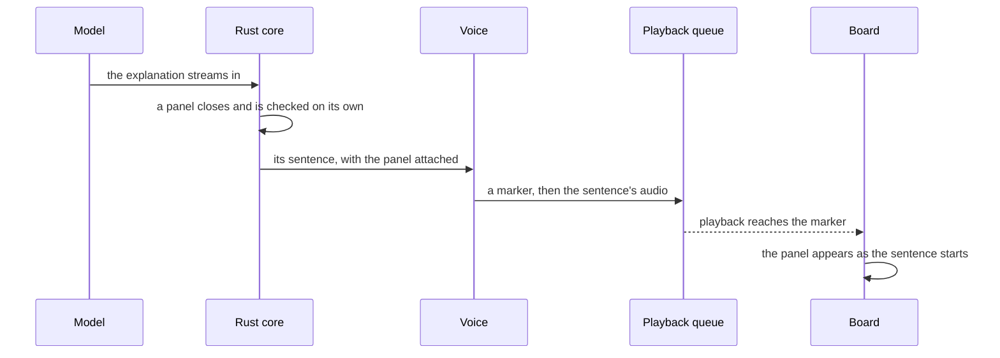

Speech is synthesized ahead of playback, so a timer would drift. Instead, a zero-length marker is placed in the audio queue right before each sentence's samples, and the panel is shown when playback reaches it. If you interrupt, the queued markers are dropped with the audio.

  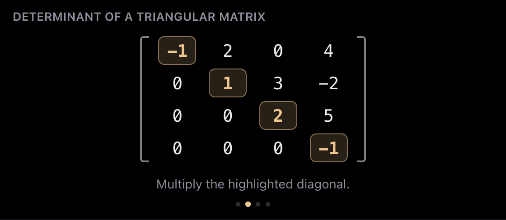
  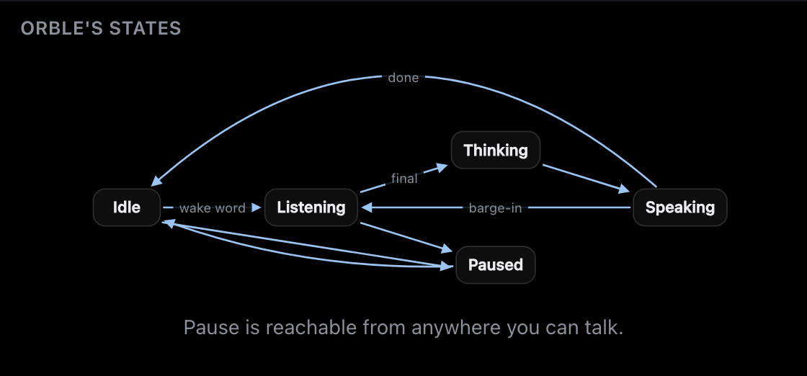

  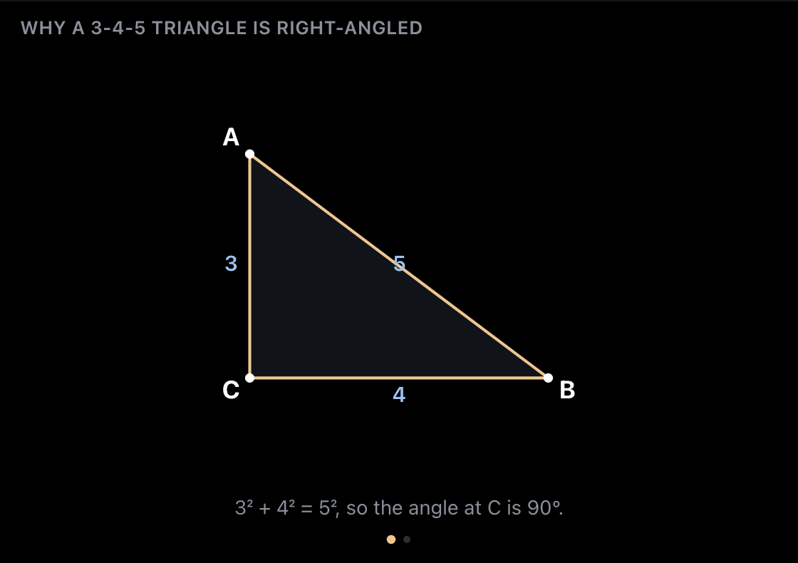
  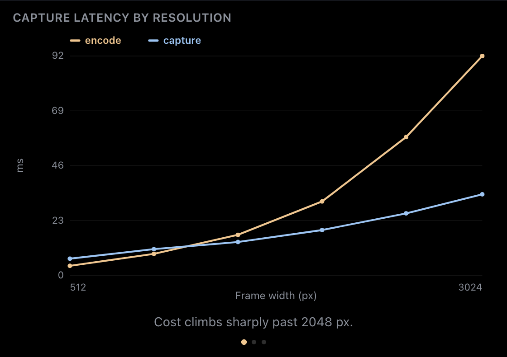

More panels and the rules behind them are in [docs/engineering.md](docs/engineering.md#the-board).

## Architecture

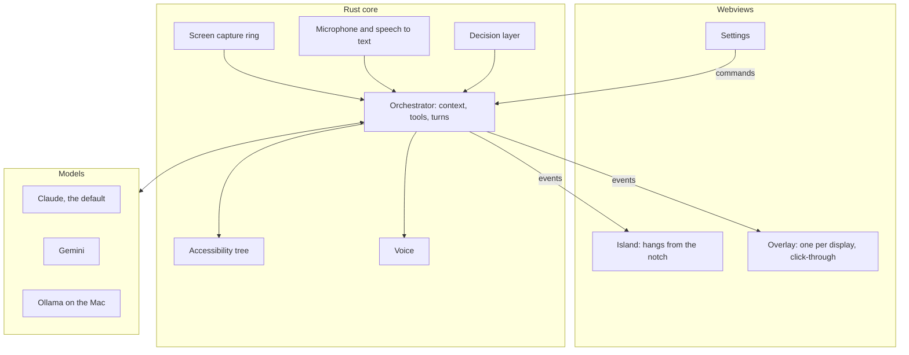

The full tour, including the threads and what each window may call, is in [docs/architecture.md](docs/architecture.md).

## Engineering

| | |
| --- | --- |
| Code | 124 Rust modules, about 129,000 lines including their tests; 50 UI scripts, no build step |
| Tests | 2,288 Rust tests, 467 UI tests in Node, 346 Python tests for the tooling |
| Snapshots | 170 checks over 70 board images rendered in headless Chrome; 18 prompt snapshot files, so any change to what a model is told fails a test until the diff is read and logged |
| Security | A threat model covering 48 outbound data flows and 15 threat classes, with 65 residual risks each tracked as an issue. A CI check fails if it cites a function, test or file that no longer exists |
| CI | Formatting, Clippy with warnings as errors, tests on Apple Silicon and on Intel under Rosetta, the minimum Rust version (1.88), cargo-deny for advisories and licences, the release bundle with and without Swift |
| Decisions | 30 written decision records, from "Orble teaches; it never drives the Mac" to "Nothing waits on the main thread under a lock the main thread takes" |
| Languages | English and French, for the interface and for what Orble says |

Some of the problems behind those numbers, in [docs/engineering.md](docs/engineering.md):

- [Pointing that lands on the control](docs/engineering.md#pointing), and why the accessibility walk never goes deep at answer time
- [Panels that land on their words](docs/engineering.md#the-board)
- [Drawing while the answer is still being written](docs/engineering.md#streaming)
- [A window that hangs from the notch on every Mac](docs/engineering.md#the-island)
- [Interrupting a voice the microphone can hear](docs/engineering.md#barge-in)
- [Not paying for silence](docs/engineering.md#cost)
- [Privacy that is checked](docs/engineering.md#privacy)
- [Testing an app no test can launch](docs/engineering.md#testing)

## How it was built

Orble has 1,091 commits made between 14 August and 4 November 2026. I designed it and directed the work. Most of the code was written by AI coding agents (Claude Code), several at a time, each in its own git worktree. My part was the product, the specifications, the order of work, the rules the code must keep, and deciding what ships. Every batch is read by independent review agents and must pass the full test suite before I merge it.

The project's instruction file keeps the hard-won rules, so the same mistake is not made twice. Two examples: "A transparent window still swallows clicks", and "Frames arriving don't prove Screen Recording".

## Status

Pre-release. Orble runs from source on macOS 13 and later. There is no signed public build yet. It uses Claude Sonnet 5.5 by default, with Claude Opus 5.5, Gemini and local Ollama models also supported. AssemblyAI and ElevenLabs are optional for streaming speech and voices. Each service uses your own key, and Privacy Mode needs none.

## Licence

Copyright © 2026 Erwan Dilliers. All rights reserved. This repository is published for review only; see [LICENSE](LICENSE).
