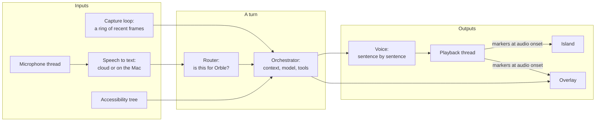

# Architecture

Orble is one Rust process with a few webviews. The webviews draw; the Rust core decides. There is no frontend framework and no build step: the pages are plain HTML, CSS and JavaScript loaded directly by Tauri 2's webview.

## The windows

| Window | What it is | Why it is built this way |
| --- | --- | --- |
| Island | A black shape hanging from the MacBook's camera housing. A stem exactly the notch's width overlaps it, and a panel grows downward only when there is something to hold: the reply's caption, the composer, Recent answers, the explanation board, setup. | It reads as part of the hardware. A chat panel or a floating card would compete with the app the user is learning. |
| Overlay | A full-screen, click-through layer per display, for marks, arrows and labels. | It never takes a click or the keyboard, so the user's app keeps working under it. It is taken off screen whenever nothing on it is live. |
| Settings | An ordinary window. | Settings is the one place where a normal window is the right answer. |

The island floats at the status window level, just above the menu bar. The overlays float above that. Both join every Space and stay out of the window cycle, and Orble reasserts this on every Space switch, because macOS re-constrains windows in the menu bar strip.

Only one panel is open at a time, and one small model (`island_model.js`, tested in Node with no browser) decides which one and what closes it: its icon, Esc, losing focus, the pointer leaving, or a timeout for a panel that opened by itself. An earlier design let each panel manage its own visibility with classes and timers, and a list of past chats that never closed was the result.

## The core

The long-lived workers (capture, microphone, playback, listener, decision prober) each beat a watchdog with a due time. A worker about to sleep for a long time says so first, so a long wait is never mistaken for a stall. A stalled or panicked worker is restarted, with a backoff, and gives up after three restarts in 30 minutes, saying so once.

## The life of a question

1. **Heard.** A streaming recognizer, or one on the Mac, produces a final transcript. If it arrives while Orble is speaking and mostly repeats what Orble said, it is the speakers' echo and is dropped.
2. **Routed.** Speech heard in the moments after an answer, without the wake word, goes to the decision layer: a small model, Jev by default, that answers closed questions in a few hundred milliseconds. Is this addressed to Orble? In a live guide, does it mean "next" or "go back"? Typed input is never dropped.
3. **Framed.** The question gets exactly one screenshot, settled after the capture pause check, labelled with its pixel size and capped so the model provider never rescales it. A circled region, if there is one, is drawn into that frame first.
4. **Assembled.** The system prompt has a stable core, which is cached, and a volatile part with the frontmost app, its knowledge pack, the learner's notes and the language. Switching apps changes only the volatile part, so the cache survives.
5. **Answered.** The reply streams. Sentences go to the voice as they complete. Tool calls (pointing, drawing, explaining, looking closer, looking back in time, starting a guide) are parsed as their input streams, and a mark is placed while the rest of the answer is still being written.
6. **Shown.** Each mark and board panel waits in the audio queue for the sentence that names it, then appears when playback reaches it. If the user interrupts, the generation counter moves on, and everything queued for the old turn is dropped.

## Pages and the core

Every event from the core to a page is defined once, in one table in Rust, with its name, its target window as a type, and its payload. The page-side list and the documentation are generated from that table, and a test fails on any send that bypasses it. Each window is granted only the commands its page actually calls, and a test checks the grants against the pages. The content security policy allows no inline script or style.

## Models

| Role | In the cloud | On the Mac |
| --- | --- | --- |
| Chat | Claude Sonnet 5.5 by default; Claude Opus 5.5, Gemini | A model through Ollama |
| Pointing | Claude grounds pixels; Gemini's text detection without a Claude key | A vision model through Ollama |
| Decisions | Jev, TypeSafe's hosted decision model | A model at a loopback address that speaks the same protocol, or none: everything falls through to the full model |
| Speech to text | AssemblyAI streaming | whisper.cpp, Apple's on-device recognizer, a local speech app |
| Voice | ElevenLabs | A local speech server, or macOS's own voices |

A missing optional key is not an error. Orble falls back to the local path and says so once. Why each piece is where it is: [decisions.md](decisions.md).

## Privacy, in one rule

Every reason to pause capture goes through one function: the Mac is away, the user paused it, another app shares the screen, or a password manager, finance app or meeting app is in front. While paused for any reason that hides the app, nothing about the front app reaches a model, including its name. In Privacy Mode, every model, ear and voice must be at a loopback address, and the HTTP client builder exempts loopback from system proxies. See [engineering.md](engineering.md#privacy).
