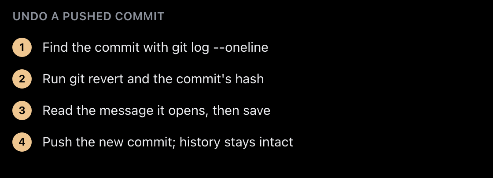
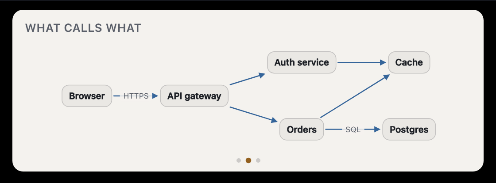
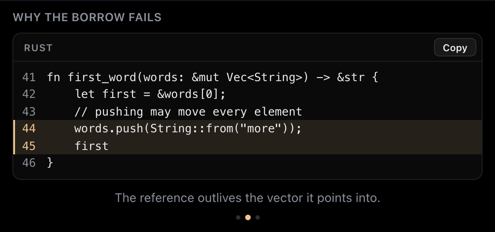
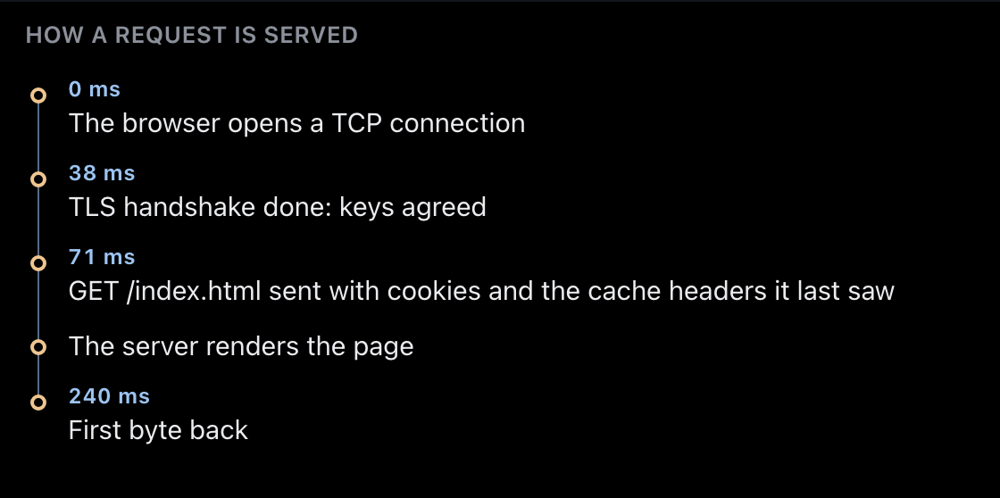

# Engineering notes

These are problems Orble ran into, and how each was solved. Most of the solutions came from measuring first. The code excerpts are from the private source, lightly trimmed.

## Pointing

**The problem.** A vision model looks at a downscaled screenshot. Its boxes are accurate to roughly 1 to 2 percent of the frame, which is 15 to 30 points on a 14-inch display. That is the "it circles it, but it's off by a couple" that users notice immediately.

**The fix.** The model's box only decides *which* control is meant. The geometry that gets drawn comes from macOS's accessibility tree, which knows each control's frame to the point. Orble asks the question the way a click would: it hit-tests the centre of the guess, climbs to the nearest control a person acts on, and accepts the answer only if it is plausible.

```rust
/// Conservative by construction: snaps only to a control that genuinely
/// overlaps the guess and is not much larger than it, so a miss keeps the
/// vision box rather than confidently pointing somewhere new.
pub fn snap(guess: (f64, f64, f64, f64), controls: &[Control]) -> Option<Control> {
    let gw = guess.2 - guess.0;
    let gh = guess.3 - guess.1;
    if gw <= 0.0 || gh <= 0.0 {
        return None;
    }
    let garea = gw * gh;
    let (gcx, gcy) = ((guess.0 + guess.2) / 2.0, (guess.1 + guess.3) / 2.0);

    let mut best: Option<(f64, &Control)> = None;
    for c in controls {
        if c.w < 2.0 || c.h < 2.0 || c.area() > garea * SNAP_MAX_GROWTH {
            continue;
        }
        let b = c.bounds();
        let overlap = iou(guess, b);
        // Either the boxes agree well, or the guess's center lands inside a
        // control that is a plausible size for it — the common case when the
        // model boxes a button's label instead of its whole hit area.
        let centered = gcx >= b.0 && gcx <= b.2 && gcy >= b.1 && gcy <= b.3;
        if overlap < SNAP_MIN_IOU && !(centered && overlap > 0.05) {
            continue;
        }
        if overlap < SNAP_MIN_IOU && c.area() < garea * SNAP_MIN_SHRINK {
            continue;
        }
        // Prefer agreement; break ties toward the tighter control.
        let score = overlap + if centered { 0.15 } else { 0.0 };
        if best.as_ref().is_none_or(|(s, _)| score > *s) {
            best = Some((score, c));
        }
    }
    best.map(|(_, c)| c.clone())
}
```

**What measuring changed.**

- *Hit-test a point; never walk the tree at answer time.* A full walk of an Electron app's accessibility tree is about 10,000 IPC round trips and 300 to 500 ms. Under any budget a hint can wait for, a walk returns the menu bar and none of the window's content.
- *The tree is deeper than it looks, and mostly menus.* The walk's depth cap was 14. The deepest reachable control in one editor's sidebar was at depth 31, so controls plainly on screen came back "not found". Menus were 424 of that app's 517 nodes, so closed menus are no longer descended into, which made depth 40 affordable. That app went from 15 controls found to 54.
- *A word in a description is not a control's name.* "The src folder in the file explorer" once snapped onto the File menu, 171 points away. Titles now match as whole words, and a name match counts only within 80 points of the guess. Real matches land within 12.
- *Not every model can point through tool arguments.* Measured on synthetic screens with targets at known positions, Gemini's coordinates in function-call arguments were 100 to 200 pixels off, whatever the fields were named. It is accurate only in its trained output, plain-text JSON with `box_2d` normalised to 0 to 1000. So Gemini's pointing tools take a description of the target, and a separate call grounds it: Claude, in real pixels, when a Claude key exists, else Gemini's own text detection.
- *One screenshot per turn, at a size that is never rescaled.* Captures are capped so the provider never resizes them internally, and each is labelled with its exact width and height. A model's pixel then maps one to one to the screen. Coordinates are always resolved against the frame the model was shown, never the newest one in the ring: the ring keeps moving, for example following the pointer to another display. The mapping is pure and tested on 5K, XDR, scaled 4K, portrait, ultrawide and displays with negative origins.

## The board

The board is for anything the user has to read: 13 panel kinds, from equations and matrices to graphs, trees, timelines and side-by-side comparisons. Panels carry content and structure only, never coordinates. The board does all the layout, which is why it is safe to give to a model that is weak at coordinates.

**Landing on the words.** Speech is synthesized ahead of playback, so a timer would drift. Each panel instead rides the audio queue itself:

```rust
/// Zero-length queue entry that fires a Tauri event the moment playback
/// reaches it — the sync primitive behind speech-timed board panels
/// (`explain`): the marker is appended right before its
/// sentence's samples, so the event lands exactly at that sentence's
/// audio onset, no matter how far synthesis runs ahead of the speaker.
Marker {
    gen: u64,
    event: crate::events::CueEvent,
    payload: serde_json::Value,
},
```

```rust
Ok(PlayCmd::Marker { gen, event, payload }) => {
    if gen == state.current_gen() {
        match &out {
            Some(o) => {
                let st = state.clone();
                o.sink.append(rodio::source::EmptyCallback::<f32>::new(Box::new(move || {
                    // Re-check at fire time: a barge-in may
                    // have bumped the generation while this
                    // marker sat in the queue.
                    if gen == st.current_gen() {
                        crate::events::emit(&st.app, event.with(payload.clone()));
                    }
                })));
                o.sink.play();
            }
            // No speaker to sync with: show it now.
            None => crate::events::emit(&state.app, event.with(payload)),
        }
    }
}
```

A numbered procedure spoken over several sentences is revealed one step per sentence. On a muted Mac, or during a call, there is no voice to follow, so the whole panel is shown at once.

**Rules that keep it readable.** Sizes are in pixels, never viewport units, because the island's window hugs its content. The stage stops at 420 px and scrolls. A text panel holds at most 40 words. A code panel has no syntax colours: without a real tokenizer they guess wrong. The board can be copied as an image, SVG or Markdown, and the copy is rebuilt from the panel's content, never from the page, so a copied SVG contains only elements the exporter made.

<p align="center">
  
  
</p>
<p align="center">
  
  
</p>

## Streaming

Claude streams a tool call's input as JSON fragments. Orble reads them as raw bytes, never decoding a string before it closes, and hands out each piece the moment its object closes: the explanation's title, each panel, each shape of a drawing. That means:

- the board opens on the title while the panels are still being written;
- a mark is grounded and queued as its call closes, while the rest of the answer is still streaming;
- one rule keeps the order the model intended: a call streams only while every client call before it in the response also streamed. Anything else waits for the tool loop and is shown whole in its place.

Edge cases are handled explicitly. A call left open by a `max_tokens` stop never paints. If a response is refused, or handed to a fallback model after something already streamed, the turn moves to a new generation: its queued sentences, panels and marks are dropped, and anything already drawn comes down. Every parser that reads bytes from a service, a file or another app is run against a few thousand generated inputs, including valid input damaged the way a broken or hostile peer would damage it, and streams cut at random points. This matters because a stream can split a multi-byte UTF-8 character across chunks. Decoding per chunk once turned every such split into a replacement character in the spoken text.

## The island

**Never guess the notch.** Its width and the menu bar's height differ between the 14-inch and 16-inch MacBook Pro, and display scaling changes every number. An early version used a fixed 236 by 38 point capsule at top centre, and it sat almost entirely behind the camera housing, invisible and unclickable. Orble now reads `auxiliaryTopLeftArea` and `auxiliaryTopRightArea` from `NSScreen` for the notch's exact extent, and `safeAreaInsets` to learn whether there is a notch at all. On a display without one, it draws its own.

**A transparent window still swallows clicks.** The island's window is resized to exactly what is drawn, in the same call that re-docks it, so a resize never grows the window sideways for a frame. Its shadow bleeds downward only, into the menu bar's height.

**macOS moves it back.** Windows in the menu bar strip are re-constrained on Space switches, so the window's position is re-asserted on every move, resize, focus and scale change.

**It gets out of the way.** When a hint would sit under the island, the island slides aside and detaches from the notch. The label placement for the hint is told where the island now is.

## Barge-in

The microphone hears the speakers. Through a MacBook's built-in speakers, Orble's own voice is the loudest thing the microphone picks up. So interrupting it takes more than sound:

- a transcript that arrives during Orble's speech and mostly repeats it is the echo, and is dropped;
- a partial transcript stops the voice only if it is not an echo, has three words, and the microphone was loud above the echo floor for 500 ms of the last second;
- where the decision layer answers in time, it must also not judge the words as said to someone else, so a television across the room does not stop Orble.

"Hold on", said over the voice, stops it with no reply. "Keep going" resumes from the sentence it was cut in. The thresholds are replayed on recorded cases in tests. Each live decision also writes a log line, so the thresholds can be tuned from real measurements instead of guesses.

## Cost

**Not paying for silence.** The streaming speech service bills for the time its socket is open, not for speech, so a socket left open bills every quiet hour. A small state machine opens the socket when speech starts, with a short pre-roll so no word is lost. It holds the socket through brief pauses, sends keepalives, and closes it after 60 seconds of quiet, or at once when a call starts. Optionally, the wake word is first heard on the Mac, and only then is the cloud session opened.

**Not asking the big model what a small one can answer.** The decision layer sends closed questions to Jev, a hosted decision model: is this line for Orble, which of these listed controls is the next step. Measured over 41 calls, it answered in 481 ms at the median and 649 ms at the 95th percentile, with no answer off the list it was given. It can only ever remove a model turn. In a guide, it races the full planner on the same frame. A confident pick from the list lets Orble skip the planner's call. A low-confidence answer, a timeout, or an app with no accessibility tree leaves the step to the planner, which is already running, so the race adds no wait. A model on the Mac that speaks the same protocol can take Jev's place, and one did not pass for choosing steps: see [decisions.md](decisions.md#a-small-model-chooses-it-never-generates).

**Measuring before trusting.** Image questions to the decision model were measured before any were used. Yes/no questions about the screen were right 16 times out of 16. Boxes were another story: 4 of 24 confident boxes missed small targets by 19 to 52 points. So it is never used to place a mark, only to judge whether a manual guide step is done.

**Caching what does not change.** The system prompt is split into a stable core, which is cached, and a volatile part with the frontmost app and the learner's notes. Switching apps leaves the cache alone. A capture identical to one of the last two frames is reused without decoding or encoding it again.

## Privacy

- **One rule for every capture pause.** The Mac is away, the user paused capture, another app shares the screen, or a password manager, finance app or meeting app is in front: all of these go through one tested function. A reason checked anywhere else would drift from the one the interface shows.
- **Frames arriving don't prove permission.** Without Screen Recording permission, macOS does not fail the capture. It returns the wallpaper, and the model would happily describe "your desktop". Permission is asked of the operating system directly, never inferred from data arriving. The same goes for the microphone, which delivers silence when denied.
- **Loopback means loopback.** The HTTP library's default sent `127.0.0.1` through the system proxy, which once carried Privacy Mode's local model traffic off the Mac. Every client is now built by one function that exempts loopback, and redirects are followed only when they stay on the same side of the Mac.
- **Screen text is data.** Screenshots, text read through the accessibility tree, files and fetched pages are framed to the model as content, never instructions.
- **The clipboard is read only on request.** The person asks, and then sees what was read before sending it.
- **The claims are checked.** The threat model lists every outbound data flow, 48 in all, with its threats and residual risks. A CI step checks that every function, test and file it cites still exists. A promise the code does not keep is listed as a residual risk, not as a mitigation.

## Testing

Orble's behaviour depends on the screen, the microphone and macOS, none of which a test can drive. So the decisions are pulled out into pure functions and tested directly. Examples are which display the island hangs from, whether the Mac is away, why capture is paused, and what a key press means. Scribe's key machine is checked against every event in every state.

Around that:

- **Mock models.** A debug-only server on loopback replies with recorded response bytes, so the real parsers and the real orchestrator run unchanged in tests and demos.
- **Prompt snapshots.** The system prompt and tool schemas for five configurations, and twelve background prompts, are kept as golden files. A change fails until the diff is accepted, and each accepted change gets an entry in a prompt changelog.
- **Pixel snapshots.** Every board kind is drawn in headless Chrome over the DevTools protocol, with no dependency and no browser download. Its structure is checked everywhere and its pixels against goldens.
- **Window boundaries.** One test checks that each window's grants match the commands its page calls. Another checks that the content security policy allows no inline script or style. A third pins every event's payload bytes.
- **The pipeline test.** Synthetic screenshots with targets at known positions go through the real prompts and schemas, and the pointing error is measured in pixels.
- **Endurance.** An eight-hour soak script runs the app on mock models and samples memory, threads and file descriptors every minute.

The checks are defined as a GitHub Actions workflow: formatting, Clippy with warnings as errors, the tests on Apple Silicon and under Rosetta, the minimum supported Rust version, dependency audits, and the UI and tooling tests. The same steps run locally, one for one, before every merge. The pipeline test, which calls a real model, and the soak are run by hand.
